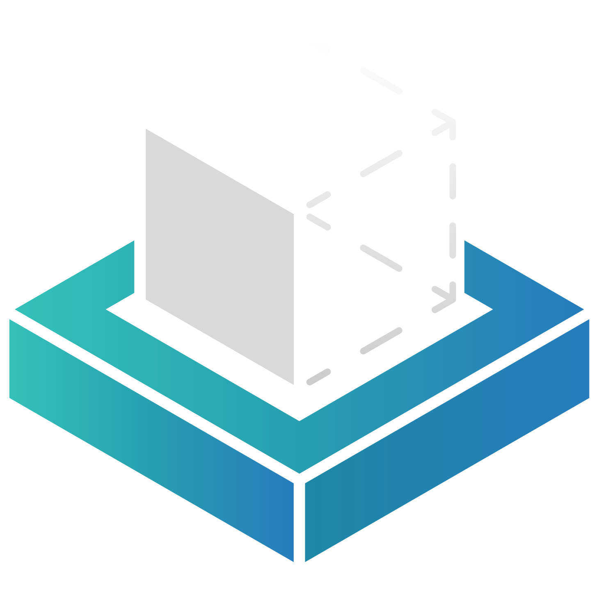

# SusDock

A SuSFS LKM manager for KernelSU, which picks the prebuilt `.ko` that matches your device from upstream releases.

**English** | [简体中文](README.zh.md)

## Upstream

Releases and prebuilt drivers come from [inforcqb/susfs4ksu-for-lkm](https://github.com/inforcqb/susfs4ksu-for-lkm) and x86_64 compatible version [ymuuuu/susfs4ksu-lkm-x64](https://github.com/ymuuuu/susfs4ksu-lkm-x64).
Thanks to its maintainer for keeping the builds up to date — SusDock **only** downloads and installs them.
Thanks also to the [SuSFS](https://github.com/simonpunk/susfs4ksu) and [KernelSU](https://github.com/tiann/KernelSU) projects.

## Usage

1. Flash the module zip in KernelSU and reboot.
2. Open the WebUI from the module card.
3. Check for updates, install one, then reboot to apply it.

The WebUI covers status, updates, logs, log level and the update source.

Requires KernelSU, arm64 or x86_64 on Android 12+. Network access is only needed for update checks and downloads.

## How it works

SusDock is split into a shell backend and a WebUI frontend.

- **Backend** (`src/module/`) reads the device fingerprint (Android version, kernel version, GKI branch), fetches the upstream release JSON, selects and downloads the matching `.ko`, verifies its sha256, records the installed version and reboot flag, and manages boot autoload and logs.
- **Frontend** (`src/webui/`) is plain TypeScript + Vite, running in KernelSU's WebView. It calls the backend through `kernelsu.exec()` and never talks to the network itself.

Commands, output formats and exit codes are documented in [docs/backend-api.md](docs/backend-api.md).

## License

GPL-2.0, see [LICENSE](LICENSE).
